# NO_HANDS

*Made by Jakub Rządzki · WIEIK IWIK R2S3* (the same mark is in the corner of every preview
window).

Control your computer through a webcam without touching it. You get a mouse driven by hand
gestures, a presenter's remote in your hand, a cursor that follows your eyes, and arrow keys
from head movements. Everything runs locally on the CPU, no GPU needed. MediaPipe tracks the
hands and the face, and pynput sends the mouse and keyboard input.

| Mode | `python main.py` + | What it does | Good for |
| --- | --- | --- | --- |
| Hand mouse | (nothing) | cursor, clicks, drag, scroll, zoom; a media mode for music | everyday use instead of a mouse |
| Slides | `--slides` | hand strokes: previous / next slide, zoom in / out | presentations |
| Eyes | `--eyes` | the cursor follows your gaze, blinks click | hands busy, accessibility; large targets |
| Head | `--head` | quick head turns and nods press the arrow keys | slides, photos, lists, video |

Runs on Windows, Linux (X11) and macOS; see [Limitations](#limitations).

**Contents:** [What's new](#whats-new) · [Install](#install) · [First run](#first-run) ·
[All gestures at a glance](#all-gestures-at-a-glance) · [Hand mouse](#hand-mouse-default) ·
[Media mode](#media-mode) · [Slides](#slides---slides) ·
[Presenting step by step](#presenting-step-by-step) · [Eyes](#eyes---eyes) ·
[Head](#head---head) · [Options](#options) · [The preview window](#the-preview-window) ·
[Tuning and troubleshooting](#tuning-and-troubleshooting) · [Limitations](#limitations) ·
[How it works](#how-it-works) · [Development](#development)

## What's new

The latest changes, newest first. Each one came from testing with real users, or from a
problem found while measuring.

- **A better eye tracker (`--eyes`), with ideas from two other projects:**
  - **The head's tilt is compensated.** The gaze network of
    [computer_pointer_controller](https://github.com/Ileriayo/computer_pointer_controller) gets
    all three head angles (yaw, pitch *and roll*) next to the eye images. Here roll was
    missing: the iris offset is measured along the eye's own axes, which tilt with the head.
    In simulation a 10° tilt put the cursor ~105 px off (median); now ~28 px. The saved
    calibration is from the older model, so the first run recalibrates.
  - **Dwell click** (`--eyes-click dwell`, `--eyes-dwell 0.8`), as in Microsoft
    [EyeDrive](https://github.com/microsoft/eyedrive) and Windows Eye Control: rest the cursor
    on a spot for 1 s and it clicks, once. It clicks again only after the cursor has moved to a
    new spot. No blink is needed, and a blink can shake the gaze off the target.
    `--eyes-click both` takes either.
  - **Eyes off = stop** (EyeDrive's EyesOff): a gaze well outside the screen (the keyboard,
    the desk) moves and scrolls nothing. Before, it dragged the cursor to the screen edge, and
    in scroll mode looking at the keyboard scrolled down at full speed. After 0.25 s the HUD
    says EYES OFF and a dwell click in progress is cancelled.
  - **The scroll mode is a joystick** (EyeDrive's drive buttons): near the left / right edge
    it scrolls sideways too, and the centre is "stop". `--eyes-no-hscroll` turns sideways off.
  - `--eyes-nudge GAIN` sets the head fine-tuning from the command line (0 = off).
- **Scroll with a stop sign:** raise the other hand, palm to the camera, fingers up (like a
  stop sign), and move this hand up or down. The stop hand is a modifier key, so scrolling
  clashes with no pose of the cursor hand. The two-finger scroll (it kept swapping with the
  precision V) and the scroll with the hand turned sideways are still there, off by default
  (`scroll_two_fingers`, `scroll_sideways`).
- **A loose finger gun works, and it never zooms the screen.** The other fingers only have to
  be clearly lower than the index, not folded all the way; before, a gun with the pinky half
  out was read as the horns, so moving it zoomed the screen and the slide stayed. The horns
  now need the pinky straight. The preview shows what a gun is missing ("thumb up",
  "point to the side", ...).
- **The magnifier is gone.** A loosely made finger gun looked like the magnifier's V to the
  other hand, so the system magnifier came on unasked (on a 4K screen it slowed the whole
  computer down), and turning it off sent Win + Esc, whose Esc could reach the preview window
  and quit the program without a word. The log now always says why the program ended, and a
  crash below Python prints where it happened.
- **Slides by finger gun:** index out, thumb up, the other fingers folded; pointing right =
  next slide, pointing left = previous, either hand (the right hand naturally points right,
  the left hand left). A pose instead of a movement, so speed, motion blur and frame rate do
  not matter. Held for a moment (0.2 s) = one slide. In the hand mouse it replaces the flick
  and the other hand's swipe, which are now off by default.
- **Slides with the other hand** in the hand mouse: swipe the hand that does not move the
  cursor left or right. The cursor hand only has the strict flick (it also points), which
  missed careful swipes, wrist flicks and one-way swipes; the other hand's swipe catches
  19–20 of 20 of each in simulation.
- **"Next" and right away "previous" both count:** an opposite swipe was taken for the hand
  coming back for 0.8 s after a swipe, now 0.45 s.
- **No false slide changes from a slowly moving hand** with a weak camera: the hand's speed is
  measured over 0.1 s instead of 0.06 s, so landmark noise no longer looks like a swipe.
- **The preview window can be clicked safely:** no toolbar or context menu (a right click
  could freeze the program), and the program never clicks on its own preview (on Windows a
  press on its title bar could freeze it).
- **A click stays a click:** the drag starts only when the hand clearly moves (~3 cm), never
  because the pinch lasted long, and it starts from where the button went down. Before, every
  pinch longer than 0.25 s or a 40-pixel drift (closing the fingers moves the knuckles that
  far on a big screen) turned into a drag or a selection.
- **Precise pointing:** fold the pinky and the cursor moves at half speed; make a V (index +
  middle out) and it moves at a quarter of the speed. Clicking does not change the speed.
- **Zoom with two hands:** pinch both hands and pull them apart or together, in the hand mouse
  and in `--slides`. A second hand that does not pinch changes nothing.
- **Clicks that are not missed:** a pinch works with the other fingers relaxed (before, one of
  them had to be straight), and a thumb between index and middle is a left click (before,
  nothing happened). The horns zoom with half-folded fingers too.
- **The author's mark** in the corner of every preview window.
- **`--camera-test`** shows only the camera, and the log says when the preview window opens
  and when the program is slower than the camera: "no preview" is never a mystery. The window
  is moved onto the screen and to the front when it opens.
- **The left button is held while the fingers touch** (it used to be a click after a delay),
  with pinch thresholds measured on real hands: the button is down 99% of the time it is held,
  against 57% before.
- **`--slides` takes careful swipes**, and a quick pinch is "next slide". The hand mouse
  changes slides with a flick sideways and back.
- **Linux:** a warning on Wayland, where the mouse and keyboard can be controlled only in some
  windows, and a smaller camera size when Full HD is too slow (Linux and macOS; on Windows the
  size is kept, because DirectShow does not always reopen the camera).
- **Pictures of every gesture** in this README.

## All gestures at a glance

| Mode | Gesture | Does |
| --- | --- | --- |
| Hand mouse | open hand | moves the cursor |
| Hand mouse | thumb + index touching | left button (click, or drag while held) |
| Hand mouse | two quick pinches | double click |
| Hand mouse | thumb + middle | right click |
| Hand mouse | **other hand** stop sign (palm to the camera, fingers up) + this hand up / down | scroll |
| Hand mouse | horns (index + pinky), move up / down | zoom in / out |
| Hand mouse, `--slides` | both hands pinched, pull apart / together | zoom in / out |
| Hand mouse | pinky folded | cursor at 50% |
| Hand mouse | V or index + middle together (ring + pinky folded) | cursor at 25% |
| Hand mouse, `--slides` | **finger gun** (index out, thumb up) pointing right / left | next / previous slide, either hand |
| Hand mouse | **other hand** swipes left / right (off by default) | previous / next slide, while this hand points |
| Hand mouse | open hand flicked sideways and back (off by default) | previous / next slide |
| Hand mouse | fist | pause (clutch) |
| Hand mouse | shaka held 0.6 s | mouse ↔ media mode |
| Media mode | swipe / turn like a knob / fist | track / volume / play-pause |
| `--slides` | open hand left / right | previous / next slide |
| `--slides` | quick pinch | next slide |
| `--slides` | pinch, move up / down | zoom in / out |
| `--eyes` | look / blink / wink right / wink left | move / click / right click / scroll joystick |
| `--eyes --eyes-click dwell` | keep looking at a spot for 1 s | left click (once per spot) |
| `--eyes` | look away from the screen | nothing moves (eyes off) |
| `--head` | quick turn / nod | arrow keys |
| any | both eyes closed 1.5 s (`--eyes`, `--head`), `Ctrl+Alt+P` | pause |
| any | `Ctrl+Alt+Q`, `q` / `ESC` in the preview | quit |

## Install

You need Python 3.10 or newer (tested with 3.13) and a webcam.

```bash
git clone https://github.com/JakubRzadzki/NO_HANDS.git
```

```bash
cd NO_HANDS
```

```bash
python -m venv .venv
```

Activate the environment. On Windows (PowerShell or cmd):

```powershell
.venv\Scripts\activate
```

On Linux / macOS:

```bash
source .venv/bin/activate
```

```bash
pip install -r requirements.txt
```

If PowerShell refuses to run the activation script, allow local scripts once, then activate
again:

```powershell
Set-ExecutionPolicy -Scope CurrentUser RemoteSigned
```

The MediaPipe models are downloaded into `models/` on first use, so the first start needs
internet:
- `hand_landmarker.task`, ~8 MB;
- `face_landmarker.task`, ~4 MB, for `--eyes` and `--head`.

## First run

```bash
python main.py --probe-camera    # what the camera really delivers (~15 s), and the best mode
```

```bash
python main.py --dry-run         # gestures are recognised and shown, the mouse is not touched
```

```bash
python main.py                   # the real thing
```

**Emergency exit:** `Ctrl+Alt+Q`. **Pause:** `Ctrl+Alt+P`. Both work system-wide, even when the
window has no focus and with `--no-hud`. In the preview window, `q` / `ESC` quits and `p`
pauses. On every exit, including `Ctrl+C` and crashes, all held mouse buttons and keys are
released.

## Hand mouse (default)

*The pictures are drawings of the gestures, not photos (`docs/make_gesture_images.py` redraws them). Blue outline = the fingers that make the gesture, orange arrow = how the hand or head moves, green ring = the fingers touch.*

<table>
<tr><td align="center">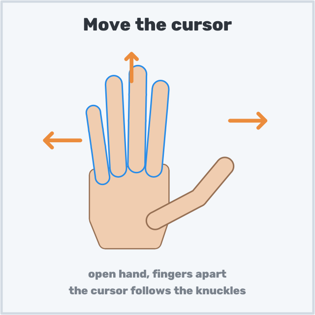</td><td align="center">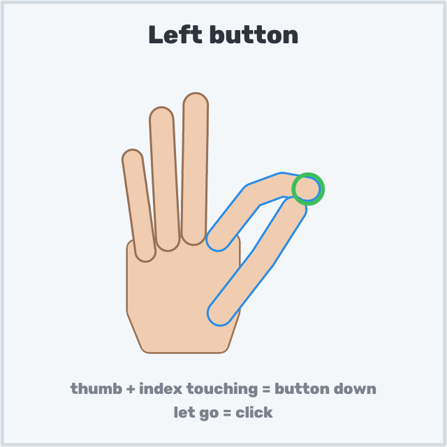</td><td align="center">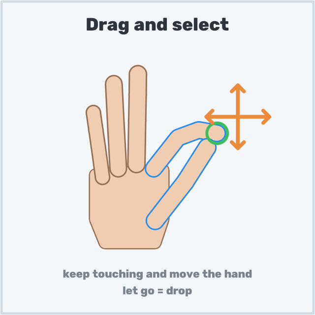</td></tr>
<tr><td align="center">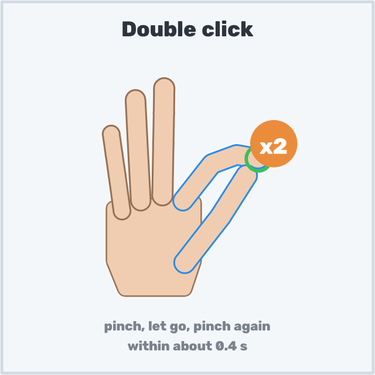</td><td align="center">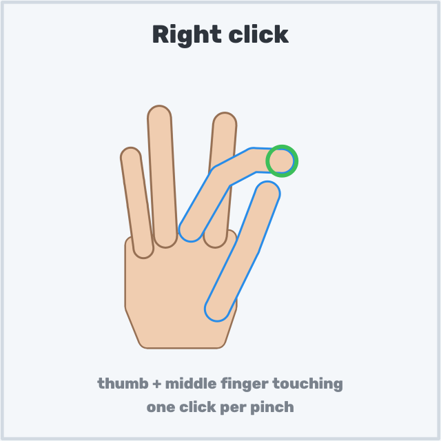</td><td align="center">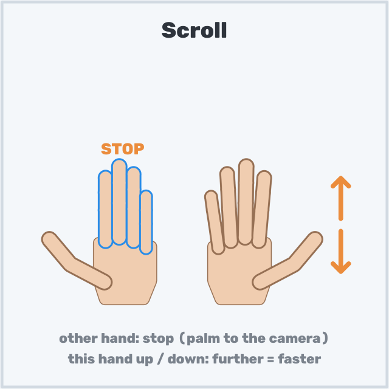</td></tr>
<tr><td align="center">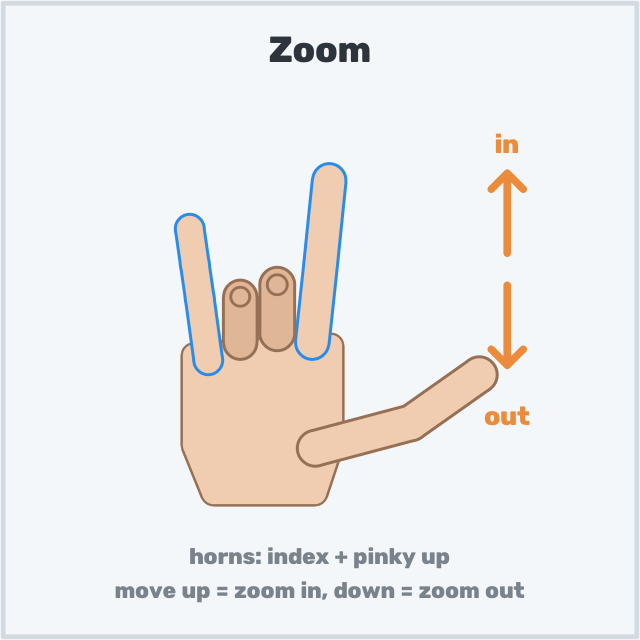</td><td align="center">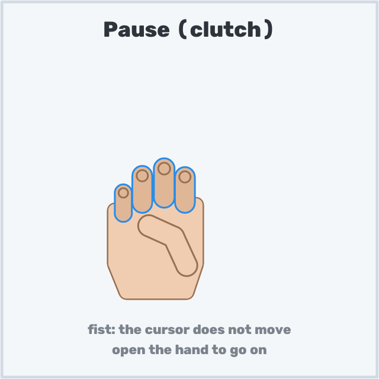</td><td align="center">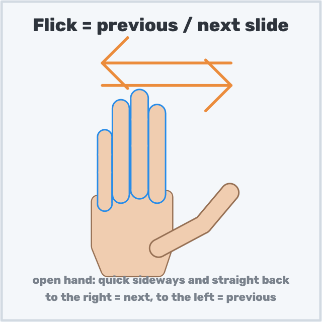</td></tr>
<tr><td align="center">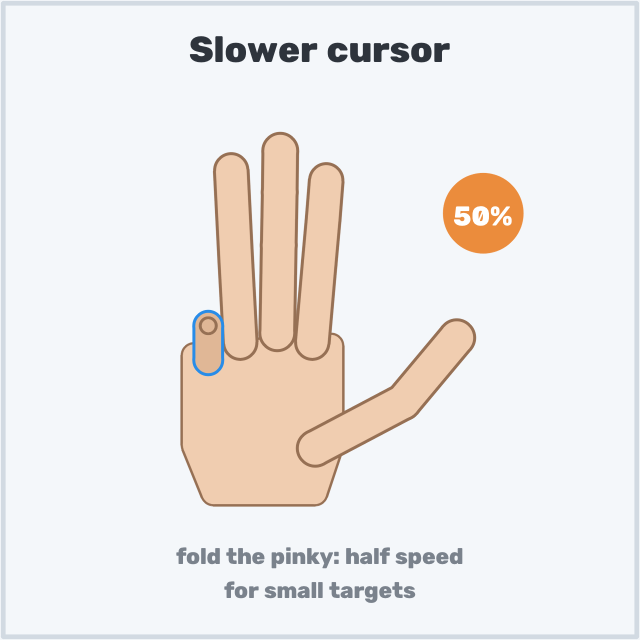</td><td align="center">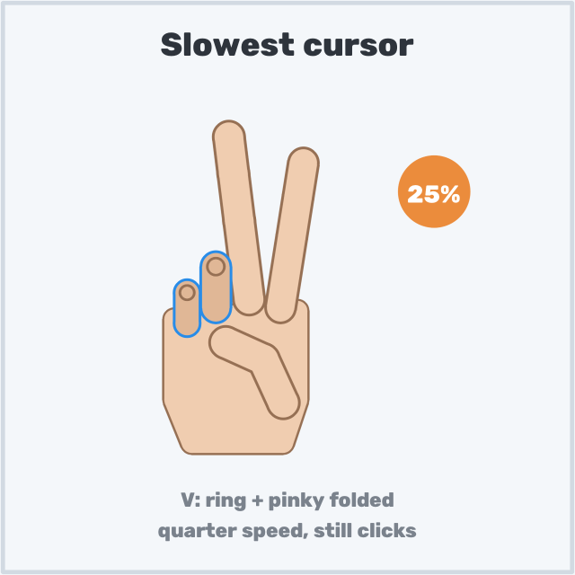</td><td align="center">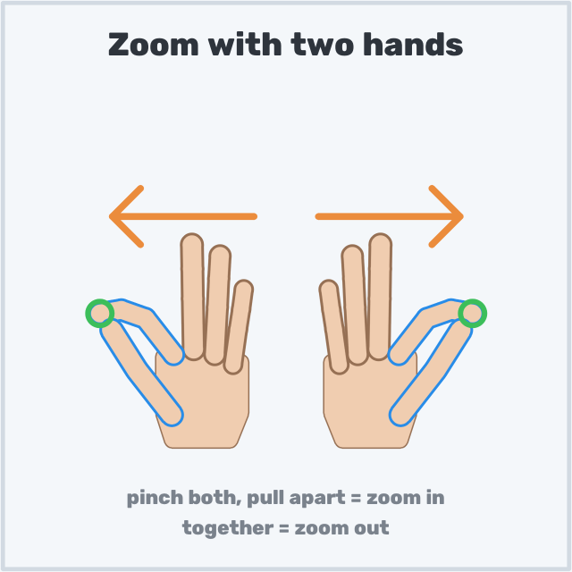</td></tr>
<tr><td align="center">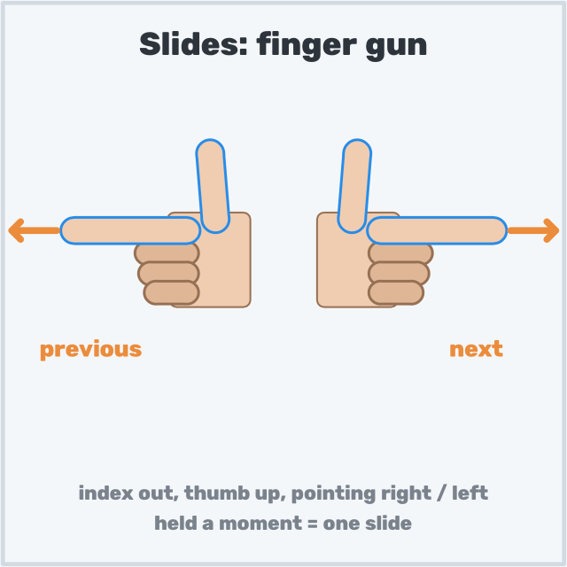</td><td align="center">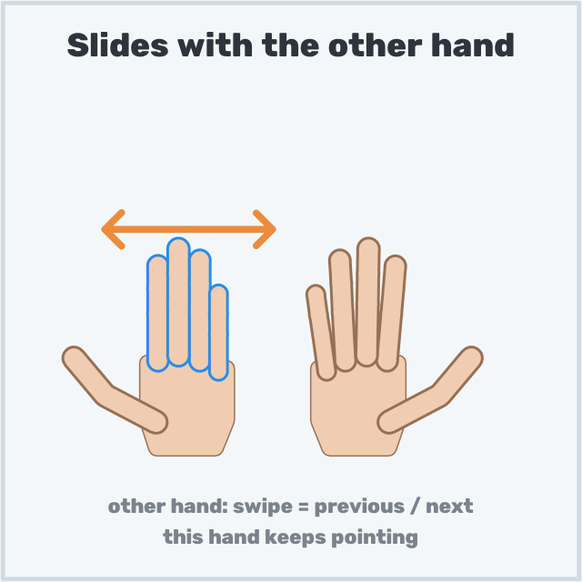</td></tr>
</table>

| Action | Gesture | Notes |
| --- | --- | --- |
| Move cursor | open hand | anchored on the knuckles (LM 5+9), not a fingertip; 1€ filter |
| Left button | **thumb + index** touching | the button is down for exactly as long as the fingers touch |
| Click | touch and let go | the cursor stays frozen while pinching, so the click lands where you aimed |
| Drag, select, draw | touch, keep touching and move | the drag starts once the hand has moved ~3 cm (0.35 palm lengths), from where the button went down; a still hand is always a click, however long the pinch |
| Double click | two quick pinches | the cursor waits 0.35 s after a click, so both land on the same pixel |
| Right click | **thumb + middle** | one click per pinch + 0.4 s cooldown |
| Next / previous slide | **finger gun**: index out, thumb up, other fingers folded, **pointing right / left** | Right / Left arrow, either hand; hold it ~0.2 s, one slide per gun; the cursor holds still meanwhile |
| Previous / next slide | **swipe the other hand** left / right | off by default (`GestureConfig.other_hand_slides = True`) |
| Previous / next slide | **flick** the open hand left / right **and straight back** | off by default (`GestureConfig.flick_slides = True`); the cursor ends where it was |
| Scroll | **the other hand shows a stop sign** (raised, palm to the camera, fingers up and straight), then **move this hand up / down** (or sideways) | works like a joystick: distance from where the scroll started sets the *speed*; dead zone. The cursor holds still and nothing clicks; lower the stop hand to point again. Off: `scroll_with_other_hand` |
| Zoom | "horns": **index + pinky** up and straight, middle + ring curled; then move the hand **up** (zoom in) or **down** (zoom out) | Ctrl + wheel, one step per ~2 cm of travel, one step per frame at most; the thumb is free |
| Zoom with two hands | **pinch both hands**, then pull them **apart** (zoom in) or **together** (zoom out) | like two fingers on a touchpad; one step per 12% change of the distance; while the other hand pinches, the cursor holds still and nothing clicks |
| Slower cursor | **fold the pinky** (index, middle, ring out) | half speed: for small targets |
| Slowest cursor | **V**: index + middle out (apart or together), ring + pinky folded | quarter speed; clicking works as usual |
| Clutch | **fist** | `absolute`: pauses output; `--relative`: "lifts the mouse" |

- **The left button is held like a real one.** It goes down the moment thumb and index meet and
  up when they part. A held button survives a few bad frames and up to 0.5 s of lost tracking.
- **Pinch with an open hand** (like an "OK" sign): at least one other finger not folded; relaxed
  is enough. With every finger folded, a pinch looks exactly like a fist, and a fist never
  clicks. When the thumb is about as close to the middle finger as to the index, it is a left
  click; a right click needs the middle finger clearly closest.
- **Precision and clicking go together.** The speed counts only the middle, ring and pinky
  fingers, so a pinch never changes it: make a V, aim at quarter speed, pinch thumb + index,
  done. Back at full speed the cursor does not jump: it catches up with the hand while the
  hand moves.
- **Two hands:** the second hand counts only while it pinches. Resting in view, on the desk or
  on the forehead, it changes nothing: the cursor moves and clicks as usual (a pinch of the
  cursor hand then waits 4 frames, so that pinching both hands at once never clicks first). A
  held button is never let go because of a second hand. Tracking two hands takes the tracker
  about twice as long (12 → 23 ms per frame here); `--no-two-hands` turns it off.
- **The finger gun's barrel says where to go.** It must point roughly sideways (up to 40° from
  level) with the thumb standing up (at least 50° from the index, its tip at least 0.6 palm
  lengths from the index knuckle). Measured: a gun's thumb stands at ~75°, about one palm
  length away; pointing at something keeps the thumb along the hand (25°, 0.2 on a real
  photo), so pointing at the slide does not fire, and neither does the slowest cursor (index
  up). Lower the hand (or open it) before the next slide. Point to the side, not at the
  camera: seen end-on, the index looks short. `GestureConfig.gun_slides = False` turns it off.
- **Why the barrel and not "right hand = next".** MediaPipe does label the hands, with 95–97%
  confidence on photos of known left and right hands, but in the mirrored preview the label is
  reversed, and it can flip. The barrel's direction is measured directly, works with one hand
  in view, and still gives "right hand points right = next, left hand points left = previous".
- **The other hand's swipe and the flick** are still there (`other_hand_slides`,
  `flick_slides`), off by default: the gun replaced them because a movement depends on speed
  and the frame rate.
- **The flick has to come straight back.** That is what tells it from moving the cursor:
  nobody points far, fast, and straight back. It also needs to be longer and faster than a
  `--slides` swipe (about 14 cm, in a snap). `GestureConfig.flick_slides = False` turns it off.
- **A pinch is "armed" only after its fingers were seen apart.** So a hand coming back into
  view mid-pinch does not click.
- **The preview's box** is the active area: the hand inside it covers the whole screen. Its colour
  shows the mode: cyan = moving, green = button down / slide changed, yellow = scroll,
  magenta = zoom (also with two hands), red = clutch, orange = media mode. The panel lists the
  gestures and shows the cursor speed when it is slowed down.

### Media mode

Hold the **shaka** 🤙 (thumb and pinky out, other fingers curled) for 0.6 s to switch between
the mouse and media mode. It is a separate mode because in mouse mode moving the open hand
sideways already moves the cursor, so it cannot also mean "next track".

<table>
<tr><td align="center">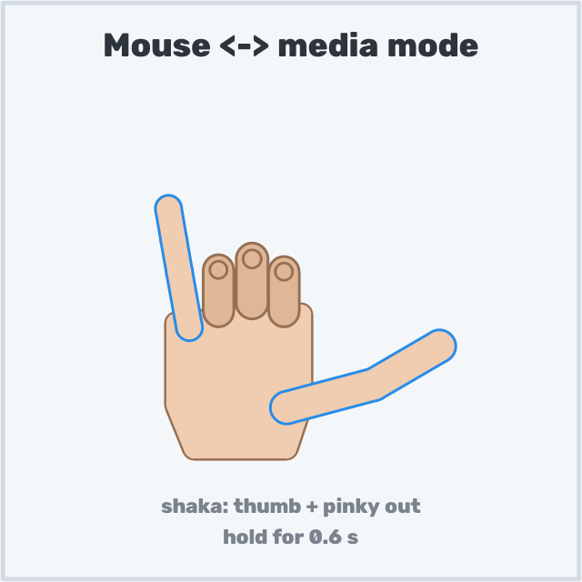</td><td align="center">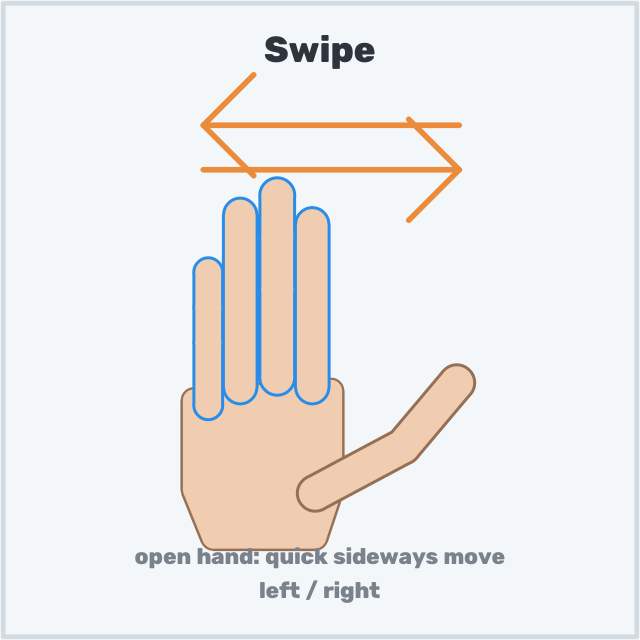</td><td align="center">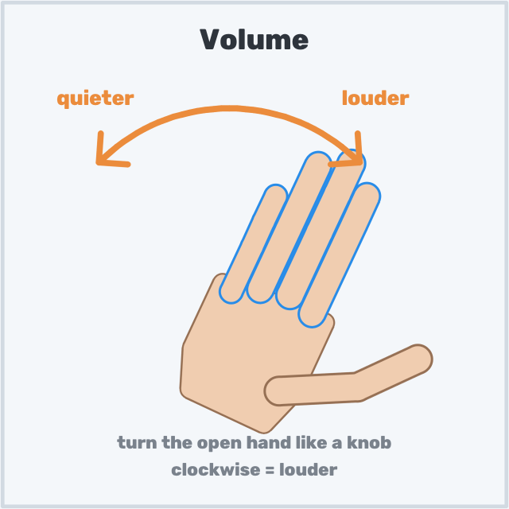</td><td align="center">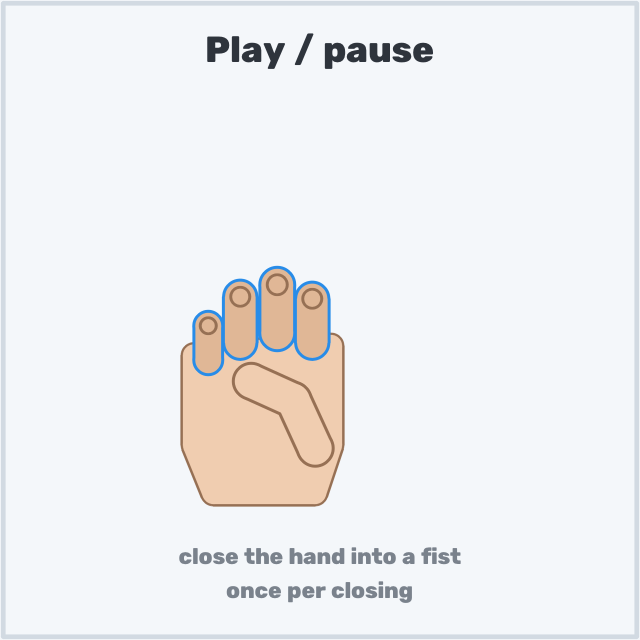</td></tr>
</table>

| Action | Gesture | Notes |
| --- | --- | --- |
| Previous / next track | quick sideways **swipe** of the open hand, left / right | ≥ 1.2 palm lengths within 0.3 s, measured at the wrist; the hand travelling back is ignored for 0.6 s |
| Volume up / down | **turn** the open hand clockwise / counter-clockwise, like a knob | 25° dead zone, then the further you turn, the faster the volume changes; back to neutral stops it |
| Play / pause | **fist** | once per closing of the hand |

- **The volume knob is a spring-loaded jog dial, not a real knob.** A wrist only turns about
  ±70°: a position-based knob would run out of range, and turning back would undo the change.
- **Media keys act system-wide.** Spotify, YouTube in a browser and other players react without
  having focus.
- **Arrow keys instead of tracks:** set `MediaConfig.swipe_action = "arrows"`. For
  presentations, use `--slides` instead.

## Slides (`--slides`)

A presenter's remote in your hand, for PowerPoint, Google Slides, Keynote, PDF viewers and
photo viewers. There is no cursor in this mode, so the hand can simply move.

<table>
<tr><td align="center"></td><td align="center">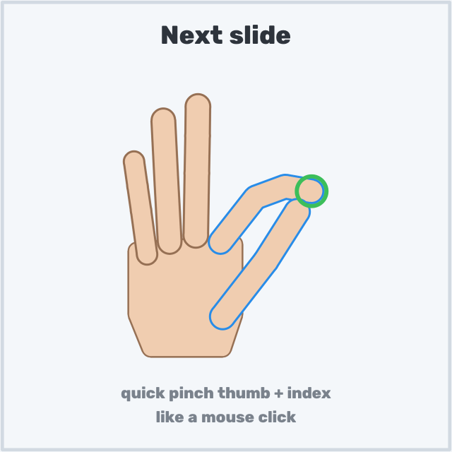</td><td align="center">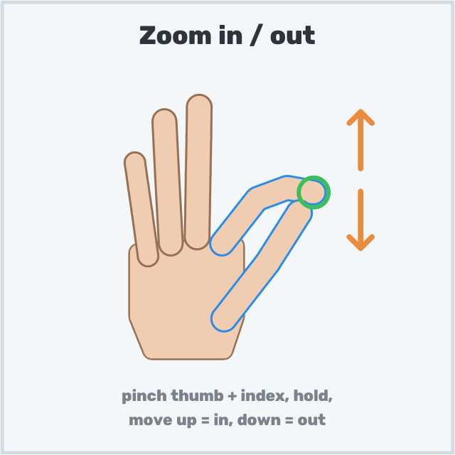</td></tr>
<tr><td align="center"></td><td align="center"></td></tr>
</table>

| Action | Gesture |
| --- | --- |
| Next / previous slide | **finger gun** pointing right / left, either hand (index out, thumb up, held ~0.2 s) |
| Previous / next slide | move the open hand left / right (Left / Right arrow) |
| Next slide | a quick **pinch** thumb + index, like a click |
| Zoom in / out | **pinch** thumb + index and move the hand up / down (Ctrl + mouse wheel, one step per ~3 cm) |
| Zoom in / out | **pinch both hands** and pull them apart / together (letting go is not "next slide") |

**Swipes the way people make them.** The slide changes as soon as the fast part of the movement
ends: when the hand slows down or turns back. You do not have to hold the hand still before or
after. These all work:
- a careful, unhurried move (about 10 cm; 20 cm taking most of a second is fast enough);
- a swipe that comes straight back;
- a swipe started while the hand is still moving into place;
- a flick of the wrist with the arm almost still.

What does not change the slide:
- **The way back.** An opposite stroke starting within 0.45 s of a swipe is the hand returning.
  Swipe right, back, right, back: two slides forward. A deliberate "previous" after a "next"
  counts once the hand has paused for a moment.
- **Swipes shorter than ~9 cm (1 palm length).** In simulation no setting caught 7–8 cm
  swipes without also turning ordinary talking gestures into slide changes.
- **Small and slow movements:** bobbing while talking, up/down beats, slowly moving the hand.
- **Raising the hand into view, lowering it out of view, or swiping off the frame edge.**
- **A fist:** make one to move the hand without swiping.

Close or far does not matter: distances are measured in palm lengths. A wide, quick sideways
gesture made while talking *is* a swipe here; `SlidesConfig.swipe_speed` and `swipe_distance`
set how big and fast a swipe has to be.

**Zoom is a pinch**, not a vertical swipe. Up/down strokes were tried first: in simulation every
up/down beat made while talking zoomed the slide. Nobody pinches by accident. While pinched,
sideways movement never changes the slide. Zoom uses Ctrl + wheel: PowerPoint's slide show
zooms with it (up to 400%), and so do browsers and PDF viewers.

The HUD shows the hand's path, the stroke as it happens and whether the hand counts as open.

### Presenting step by step

1. **Before the talk, rehearse without risk:** `python main.py --slides --dry-run`. Every
   recognised gesture is printed (`[dry-run] tap right`, `zoom`), nothing is sent.
2. **Start the program before the slide show:** `python main.py --slides`, or
   `python main.py --slides --no-hud` without the preview window (quit with `Ctrl+Alt+Q`).
3. **Click into the slide show** so that it has the focus: the arrow keys go to the window
   that is active. A click into the preview window sends them nowhere.
4. **Put the preview on the laptop screen**, not on the projector, or turn it off.
5. **Camera:** at chest or face height, the hand 40–80 cm from it, light from the front.
6. **On Windows, PowerPoint must not run "as administrator":** Windows blocks keys sent by a
   program without those rights.
7. **Need the mouse too?** Run without `--slides`: the hand points and clicks, and a finger gun
   (either hand) changes the slides.
8. **During the talk:** a finger gun pointing right / left for the next / previous slide (the
   most reliable), or move the open hand left / right; pinch to go forward,
   pinch both hands and pull apart to zoom. Make a fist to move the hand without changing
   anything, and `Ctrl+Alt+P` pauses everything. Gesture low or with the other hand: a wide,
   quick sideways movement is a swipe.

## Eyes (`--eyes`)

A mouse without hands: look where the cursor should go and click with your eyes.

<table>
<tr><td align="center">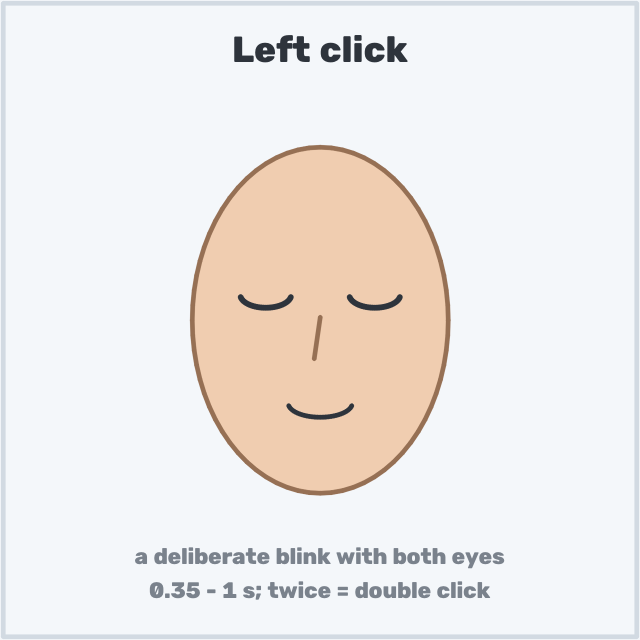</td><td align="center">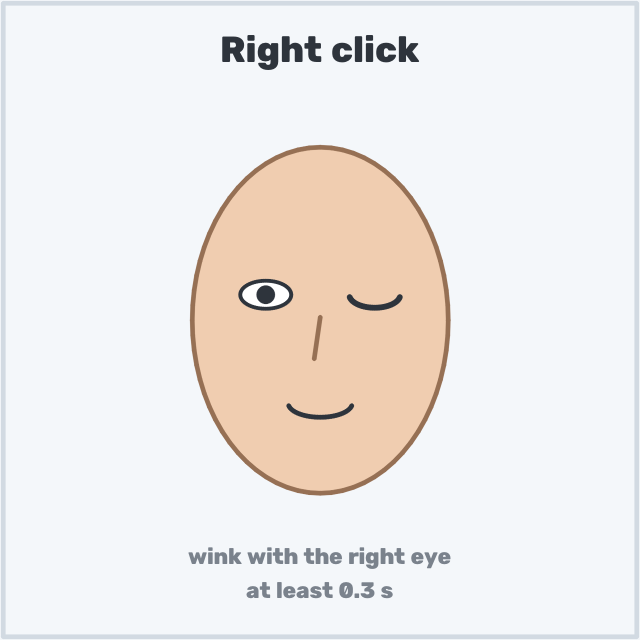</td><td align="center">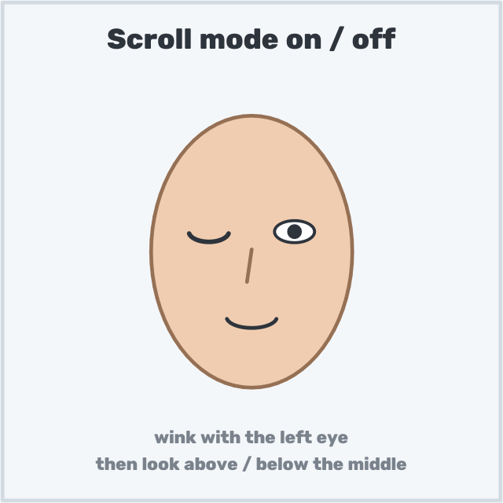</td><td align="center">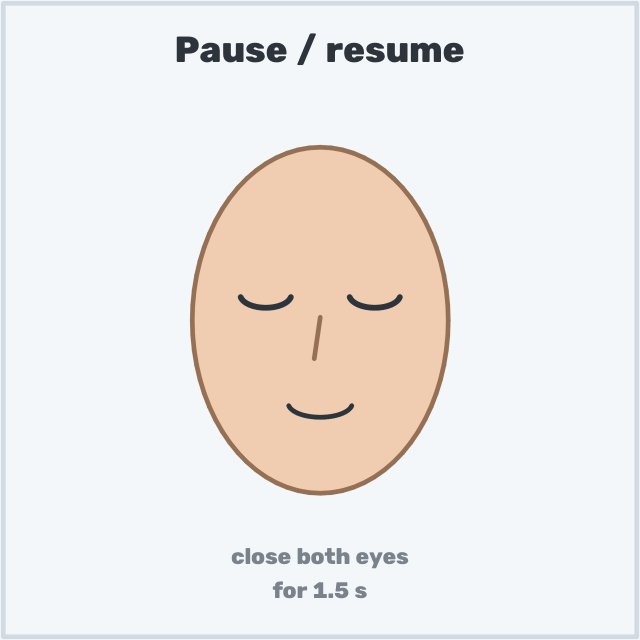</td></tr>
</table>

| Action | How |
| --- | --- |
| Move the cursor | look at the spot: the cursor jumps there and stays |
| Fine-tune the cursor | turn the head towards the target, more than 1.5° (then 3% of the screen width per degree, up to 15%) |
| Left click | a deliberate blink with both eyes, 0.35–1 s (`--eyes-click blink`, the default) |
| Left click by looking | rest the cursor on a spot for 1 s (`--eyes-click dwell` or `both`; `--eyes-dwell` sets the time) |
| Double click | a second deliberate blink within 1.2 s (`blink` and `both`) |
| Right click | wink with the right eye (≥ 0.3 s) |
| Scroll mode on / off | wink with the left eye; while on, look above / below the screen centre to scroll, near the left / right edge to scroll sideways |
| Stop everything | look away from the screen (keyboard, desk): nothing moves or scrolls |
| Pause / resume | close both eyes for 1.5 s |
| Recalibrate | `c` in the preview window |

**Calibration** takes ~30 s, full screen, on the first run and with `--recalibrate`:

1. **9 dots:** look at each until it moves on, head still.
2. **Head phase:** keep your eyes on the middle dot and turn the head where the arrow points
   (left, right, up, down). This is what later lets you move your head without the cursor
   moving, so turn properly. The result screen warns you if the head barely moved.
3. **4 check dots:** the accuracy is measured on points the fit has never seen.

The result screen and the HUD then show the accuracy and the jitter, for example `accuracy ~45 px
(2.3% of the screen width), jitter ~60 px`, and say what to fix if something is off. The
calibration is saved to `models/gaze_calibration.json`. Redo it after moving the laptop, the
camera or your chair, or when the light has changed a lot.

**What a laptop webcam can do.** The camera sees each eye as only 50–75 px wide, and across the
whole screen the iris moves by about a fifth of that. One pixel of iris noise is therefore more
than 100 screen pixels. Expect the cursor to land within 1–3 cm of where you look. That is
enough for buttons, tabs, taskbar icons and large links, not for small text links. The cursor
is built around that:

- **It jumps with your eyes, then stays put.** When your eyes jump to a new spot (a saccade),
  the cursor follows within ~0.1 s. It averages your gaze there for 0.6 s and then freezes.
  - Looking around inside that spot, including at the cursor itself, does not move it, so the
    cursor never "runs away" from your gaze.
  - A shift beyond the jump radius (~3× the jitter, shown in the log and on the gaze map)
    that was not a clear jump moves the cursor after 0.6 s of looking there.
  - **Smaller shifts never move it, on purpose.** Letting them move it was tried in
    simulation: with a calibration ~140 px off, the cursor ran away from the gaze in 20 of 20
    tries, and false moves rose from 0.8 to 2–4 per minute.
- **The last centimetres are done with the head.** After a jump, turn the head towards the
  target: past a 1.5° dead zone the cursor follows the turn. The next gaze jump resets this,
  so it never adds up. Without the dead zone a head that is never quite still pulled the
  cursor away from where you looked (+36% error in simulation). `EyeConfig.head_nudge = 0`
  turns it off.
- **Head movement is compensated.** Where you look depends on the eyes and on where the head
  points and sits. The model uses MediaPipe's 3D head pose, so turning, leaning or moving closer
  while looking at the same spot keeps the cursor there. Tilting the head sideways (roll) is
  compensated too: the iris offset is turned back into screen axes by the tilt of the eye line.

**Dwell click** (`--eyes-click dwell`): the way Windows Eye Control and Microsoft EyeDrive
click, without blinking.
- The cursor resting on one spot (within 1.5% of the screen width) for `--eyes-dwell` seconds
  (default 1.0) is a left click. The gaze map draws a green arc filling around the cursor, and
  the HUD shows `dwell NN%`.
- **One click per spot.** The next one needs the cursor to move to a new spot first, so
  reading or thinking with the eyes on one spot never clicks again and again. After a start,
  a resume or "eyes off", the cursor also has to move before anything is clicked.
- A natural blink only pauses the dwell; looking away cancels it.
- With `dwell` blinks do not click. `--eyes-click both` takes either, and two blinks still
  make a double click. Winks, the scroll mode and the pause work as always.
- The feedback is in the preview window, not next to the cursor. Start with 1–1.5 s and go
  shorter once you trust it.

**Eyes off.** A gaze estimate more than 12% of the screen outside it (`offscreen_margin`) moves
and scrolls nothing, from the first frame. After 0.25 s of that, or without a face, the HUD says
EYES OFF and a dwell click in progress is cancelled. Back on the screen, the cursor jumps to
where you look.

**The gaze map** in the preview's bottom-right corner is a small picture of the screen. It
shows what the pointer does and why:
- red dots: the raw gaze estimates of the last second;
- green ring: the fixation the cursor sits on and the jump radius;
- white cross: the cursor.

How to read it:
- red dots in a tight cloud off to one side of where you look = calibration error (recalibrate);
- a wide cloud = jitter (more light);
- red dots outside the ring while the cursor stays = a shift too small for a jump (use the head).

**Tips:**
- Light on your face matters most: a window or a lamp in front of you, not behind you.
- Keep 1920×1080 (the default): more pixels per eye.
- Calibrate at your usual distance.
- For precise work use `--eyes-pointer nose`: the cursor follows your nose, the eye gestures
  still click.

**Blinks and winks:**
- **Natural blinks** (0.1–0.3 s) are ignored. A gesture counts when the eyes open again, and
  the cursor stays frozen while they close, so a click lands where you looked.
- **Openness is relative** to each eye's own open size, learned while running, so narrow and
  wide eyes both work. Looking down lowers the lids to about 0.6–0.75 of open, well above the
  0.4 "closed" threshold. The HUD shows both eyes' openness live.
- `EyeConfig.swap_winks = True` swaps the winks.

## Head (`--head`)

Quick head movements press the arrow keys: slides, photo viewers, video players, lists.

<table>
<tr><td align="center">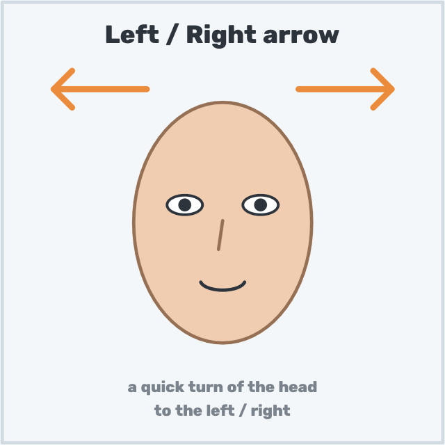</td><td align="center">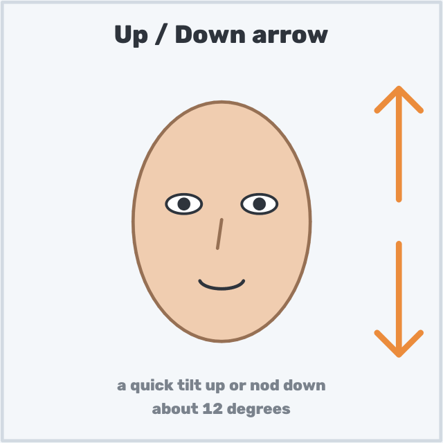</td><td align="center"></td></tr>
</table>

| Action | Head movement |
| --- | --- |
| Left / Right arrow | a quick turn left / right (15°) |
| Up / Down arrow | a quick tilt up / nod down (12°) |
| Pause / resume | close both eyes for 1.5 s |

- **Like a swipe:** the head has to get from the neutral pose past the threshold within 0.6 s.
  Slowly turning to look at something, or shifting in your chair, presses nothing. A *quick*
  look away is a gesture too, so pause before turning to talk to someone.
- **One press per move.** A move re-arms when the head is back near neutral, so returning to the
  centre never presses the opposite arrow. Holding the head there does not repeat the key;
  `HeadConfig.repeat_delay > 0` turns repeat on.
- **Neutral pose:** learned in the first half second (hold still), then it follows slow posture
  changes.
- **Angles in degrees** from MediaPipe's 3D head pose. They do not depend on how far you sit,
  and tilting the head sideways (roll) is ignored. The HUD shows them live.

## Options

| Flag | Meaning |
| --- | --- |
| `--slides` | presentations: hand strokes left / right = slides, up / down = zoom |
| `--eyes` | eye control |
| `--eyes-pointer gaze/nose` | with `--eyes`: the cursor follows the gaze (default) or the nose |
| `--recalibrate` | with `--eyes`: redo the gaze calibration |
| `--eyes-click blink/dwell/both` | with `--eyes`: left click by a deliberate blink (default), by resting the cursor on a spot, or either |
| `--eyes-dwell S` | with `--eyes`: the dwell time in seconds (default 1.0, 0.2–10); alone it also selects `--eyes-click dwell` |
| `--eyes-nudge GAIN` | with `--eyes`: head fine-tuning, screen widths per degree (default 0.03; 0 = off) |
| `--eyes-no-hscroll` | with `--eyes`: the scroll joystick scrolls up / down only |
| `--head` | head movements press the arrow keys |
| `--dry-run` | recognise gestures without touching the real mouse and keyboard |
| `--relative` | hand mouse: relative mode like a real mouse (fist = lift the mouse) |
| `--sensitivity X` | hand mouse: cursor gain; `1.5` = a third less hand travel for the same cursor travel |
| `--camera-id N` | camera index (default 0) |
| `--width/--height/--fps` | requested camera mode (default 1920×1080@60; the camera may deliver less) |
| `--probe-camera` | measure which modes the camera really delivers, suggest the best, exit |
| `--camera-test` | show only the camera picture in the preview window (no tracking, no input): the first thing to try when the preview shows nothing |
| `--camera-settings` | Windows: open the camera driver's settings (exposure, low-light compensation) |
| `--no-two-hands` | track one hand only: no two-hand zoom and nothing from the other hand (the finger gun still works with the one hand); the tracker is about twice as fast |
| `--no-hud` | no preview window (less CPU) |
| `--screen WxH` | manual screen size when auto-detection fails |
| `--model PATH`, `--no-mirror`, `--no-hotkeys`, `--log-level` | as the names say |

Everything else (thresholds, filters, speeds) is in `config.py`. It is checked at start, and
inconsistent values are reported by name.

## The preview window

The window shows the camera picture with what the program sees and does:
- **the hand's landmarks**, and the second hand in magenta when two are in view;
- **the active box** (hand mouse): the hand inside it covers the whole screen; its colour is the
  mode (cyan = moving, green = button down / slide changed, yellow = scroll, magenta = zoom,
  red = clutch, orange = media mode);
- **lines from the thumb to each fingertip**, coloured by how close the pinch is, and the line
  between the two pinches during a two-hand zoom;
- **the panel** (top left): the state, FPS of the program and of the camera, latency, the
  model's time per frame, the live measurements (pinch distances, finger ratios, cursor speed,
  eye openness, head angles, gaze accuracy) and the gestures of the mode;
- **the gaze map** (`--eyes`, bottom right) and **the author's mark** (bottom right).

The log in the terminal says when the window opens, warns when the program processes far
fewer frames than the camera delivers, and when the camera is slower than asked.
`--camera-test` shows only the camera picture, its size, FPS and brightness.

## Tuning and troubleshooting

The HUD shows the measured values live: pinch distances, finger-extension ratios, the slide
stroke, eye openness, head angles, gaze accuracy. Tune from numbers, not by feel. All
parameters are in `config.py`.

| Symptom | What to change |
| --- | --- |
| **Hand mouse:** cursor jitters while the hand is still | `FilterConfig.min_cutoff` ↓ (e.g. 0.6) |
| **Hand mouse:** cursor lags behind fast movement | `FilterConfig.beta` ↑ |
| **Hand mouse:** you have to stretch your arm | `--sensitivity 1.3` or `PointerConfig.roi_width` ↓ |
| **Hand mouse:** pinches do not register | keep another finger out (OK sign); check "pinch I" in the HUD while touching, then `GestureConfig.pinch_enter` ↑ (e.g. 0.32) |
| **Hand mouse:** the horns do not zoom | fold middle + ring further, or zoom with two hands; `horns_relaxed` (on) accepts half-folded fingers |
| **Hand mouse:** the cursor slows down on its own | a finger is half folded: open the hand fully; `precision_speeds = (1.0, 1.0, 1.0)` turns precision off |
| **Hand mouse / slides:** low FPS in the HUD (`FPS`, not `cam`) | `--no-two-hands` (looking for a second hand costs about as much as the tracking itself) |
| **Hand mouse:** the button lets go while dragging | `pinch_exit` ↑ (e.g. 0.42), `pinch_release_frames` ↑, `drag_lost_grace` ↑ |
| **Hand mouse:** the button does not let go | open the fingers further, or `pinch_exit` ↓ (above `pinch_enter`) |
| **Hand mouse:** accidental clicks | `pinch_enter` ↓, `pinch_confirm_frames` ↑ |
| **Hand mouse:** clicks select text or drag things | `GestureConfig.drag_start` ↑ (e.g. 0.5 palm lengths) |
| **Hand mouse:** a drag takes too much hand travel to start | `drag_start` ↓ (e.g. 0.25) |
| **Any mode:** the finger gun does not fire | the preview's `gun:` line says what is missing; point to the side (not at the camera), thumb clearly up, the other fingers lower than the index, hold still ~0.2 s; `gun_thumb_angle` ↓ (e.g. 40), `gun_max_tilt` ↑ (e.g. 55) |
| **Any mode:** pointing at something changes the slide | keep the thumb along the hand when pointing; `gun_thumb_angle` ↑ (e.g. 60), `gun_confirm_frames` ↑ (e.g. 10) |
| **Hand mouse:** the flick does not change the slide | use the finger gun; the flick is off by default (`flick_slides`) |
| **Slides:** a swipe is missed | swipe at least ~9 cm (a palm length), at an even pace, with an open hand, not to the frame edge; the HUD shows the stroke in palm lengths |
| **Any mode:** the program freezes or quits after a click on the preview | update (both are fixed); if it still happens, run from a terminal and send the error text it prints |
| **Hand mouse:** slides change while pointing or talking | `flick_distance` ↑, `flick_speed` ↑, or `flick_slides = False` |
| **Hand mouse:** cursor stops when the thumb rests near a finger | `approach_freeze` ↓ (0 disables freezing) |
| **Hand mouse:** scroll too fast / too slow | `scroll_gain`, `scroll_deadzone`, `scroll_max_rate` |
| **Hand mouse:** scroll does not start | the preview's `other hand:` line says what the stop sign is missing ("straighten ...", "fingers up", "palm to the camera"); hold it still ~0.25 s |
| **Hand mouse:** scroll starts by itself | the other hand is raised open in view: relax or lower it; `stop_confirm_frames` ↑, or `scroll_with_other_hand = False` and `scroll_two_fingers = True` |
| **Hands:** the hand is not found from far away | come closer, or more light; `TrackerConfig.zoom_crop` (smaller = more magnified, narrower) |
| **Slides:** swipes are not recognised | does the HUD say "open hand"? Then `SlidesConfig.swipe_speed` ↓ (e.g. 3), `swipe_distance` ↓ (e.g. 0.8) |
| **Slides:** slides change while you talk | `swipe_speed` ↑ (e.g. 6), `swipe_distance` ↑ (e.g. 1.5), `min_fingers = 4` |
| **Slides:** the way back changes the slide back | `return_window` ↑ (e.g. 1.2) |
| **Slides / hand mouse:** zoom too fast / too slow | `SlidesConfig.zoom_travel` / `GestureConfig.zoom_travel` (travel per step) |
| **Eyes:** the cursor lands far from where you look | recalibrate (`c`) with light on your face; check the accuracy it reports |
| **Eyes:** the cursor jumps on its own | `EyeConfig.fixation_radius` = 0.12 (fixed; default: automatic, 3× the jitter) |
| **Eyes:** small gaze shifts are ignored | by design (see above): nudge with the head; better light lowers the jitter and with it the radius |
| **Eyes:** the head nudge is too strong / too weak | `head_nudge` (0.03 = 3% of the screen width per degree; 0 = off) |
| **Eyes:** the cursor moves when the head moves a little | `head_nudge_deadzone` ↑ (e.g. 2.5 degrees) |
| **Eyes:** blinks click by accident | `blink_min` ↑ (e.g. 0.45), or `--eyes-click dwell` |
| **Eyes:** the dwell clicks too early / too late | `--eyes-dwell` (e.g. 1.5 / 0.7) |
| **Eyes:** the dwell never clicks | the cursor must move to a new spot first; with the nose pointer hold the head still; `dwell_radius` ↑ (e.g. 0.025) |
| **Eyes:** looking at the bottom edge counts as "eyes off" | `offscreen_margin` ↑ (e.g. 0.2), or recalibrate |
| **Eyes:** scrolling sideways when you meant up / down | `scroll_deadzone_x` ↑ (e.g. 0.4), or `--eyes-no-hscroll` |
| **Head:** arrows fire too easily | `HeadConfig.yaw_threshold` / `pitch_threshold` ↑ |
| **Head:** quick turns are missed | `gesture_time` ↑ (e.g. 0.8) or the thresholds ↓ |
| **Any mode:** low FPS in the HUD (`cam`) | more light; `--probe-camera` for a faster mode, then `--width 1280 --height 720` (on Linux and macOS a slow Full HD mode is replaced automatically) |
| **Any mode:** the preview is black or does not appear | `python main.py --camera-test` shows only the camera. Picture there: the camera and the window work; read the log (`Preview window ... is open`, and a warning if the program is slower than the camera: then `--width 1280 --height 720`). No picture there: `python main.py --probe-camera`, `--camera-id 1`, close other programs that use the camera. The window may also be behind others: it is moved to the front when it opens |
| **Linux:** clicks and keys get lost, the cursor moves only over some windows | the session is Wayland (the log says so): log in with an X11 / Xorg session |

## Limitations

- **Linux:**
  - **X11 sessions only.** Under Wayland the mouse and keyboard can be controlled only in some
    windows (those running through XWayland), so clicks and keys get lost. The app warns at
    start. On the login screen pick an X11 session (Ubuntu: the gear icon → "Ubuntu on Xorg").
  - MediaPipe loads `libEGL.so.1`, so minimal systems need the `libegl1` package.
  - Some cameras deliver Full HD only uncompressed, at 5–10 FPS. When the measured rate is
    below 20 FPS, the app switches to 1280×720 or 640×480 by itself and says so
    (`--width` / `--height` keep a size).
- **macOS:**
  - The terminal needs the Accessibility (control) and Input Monitoring (global hotkeys)
    permissions.
  - Ctrl + wheel does not zoom in most macOS apps; set `OutputConfig.zoom_modifier = "cmd"`.
  - MediaPipe 1.2.2 has no wheels for Intel Macs.
- **Multiple monitors:** Windows and macOS map onto the primary monitor, X11 onto the whole
  virtual desktop. Set a different area with `--screen`.
- **Far hands:** MediaPipe's palm detector sees the whole frame scaled down to 192 px, so a hand
  that is small in the frame (far from the camera, wide-angle lens) can be missed.
  - When the normal search finds nothing, the centre 60% of the frame is searched again,
    magnified (`TrackerConfig.zoom_crop`). On real hand photos at several sizes that found a
    hand in 48% more frames.
  - A far hand near the frame edge can still be missed.
- **Hands:** one hand drives the cursor; the other one only zooms (while it pinches) and fires
  the finger gun. When the hands cross, the tracker may swap them: the
  cursor then follows the hand nearest to where it was.
- **Face:** `--eyes` and `--head` track one face, which must be reasonably large in the frame:
  sit within about 1 m.
- **Eyes:** 1–3 cm of accuracy is what a laptop webcam allows; see [Eyes](#eyes---eyes).
- **Slides:** a wide, quick sideways gesture while talking changes the slide: no detector can
  tell it from a swipe of the same size and speed. Keep a fist while gesturing, or pause.
- **Pinch:** it needs an open hand (another finger out, relaxed is enough). With every finger
  folded, a pinch and a fist give the same landmarks.
- **Eyes:** shifts smaller than the jump radius (~3× the jitter) need the head; see above.

## How it works

### Architecture

```text
                ┌─▶ HandTracker ─┬─▶ GestureEngine  (mouse, media) ──┐
camera thread ──┤   (MediaPipe)  └─▶ SlideGestures  (--slides)       │
(newest frame)  │                                                    ├─▶ OSController ─▶ OS
                └─▶ FaceTracker ─┬─▶ EyeEngine      (--eyes)         │   (pynput)
                    (MediaPipe)  └─▶ HeadArrows     (--head)       ──┘
```

Each run uses one tracker and one engine, chosen by the flag. The engines never call the OS:
they return action objects (`Click`, `Press`, `Scroll`, …). That is why the state machines are
tested without a camera and a display:
- **Hands:** synthetic hands (`tests/handgen.py`), and landmarks of real hands
  (`tests/data/real_hands.json`, MediaPipe output for public MediaPipe sample photos).
  Synthetic hands are tidy; the problems users reported only showed on the real ones.
- **Eyes and head:** synthetic faces (`tests/facegen.py`) and a simulated laptop user
  (`tests/gazesim.py`). The simulated user has real geometry: a 15.6" screen with the camera
  above it, eyes that turn inside a moving head, and webcam noise that wanders from frame to
  frame. The gaze model and the fixation filter are tuned against it.

| File | Responsibility |
| --- | --- |
| `main.py` | command line, the main loops, guaranteed release of held buttons and keys |
| `config.py` | all parameters as dataclasses + consistency validation (e.g. `pinch_enter < pinch_exit`) |
| `src/camera.py` | a thread that keeps draining the camera and holds only the newest frame; falls back to a smaller size when the camera is too slow; `--probe-camera` |
| `src/hand_tracker.py` | MediaPipe `HandLandmarker` (VIDEO mode), the second search for far hands, the second hand for the two-hand zoom (the cursor keeps following the same hand), landmarks in isotropic pixel space |
| `src/smoother.py` | 1€ filter for vectors (one shared cutoff frequency for x and y) |
| `src/pointer.py` | active region (ROI) matched to the screen's aspect ratio, absolute/relative mapping, precision speed without jumps |
| `src/gesture_engine.py` | hand features, debounced posture classification, the pinch button (press / hold / release), right click, scroll, zoom, flick, finger gun, precision speed, two-hand mode |
| `src/media_gestures.py` | media mode: swipes, volume jog dial, play/pause |
| `src/pinch.py` | the hysteresis latch and the thumb-to-fingertip distance shared by every pinch |
| `src/two_hands.py` | the zoom with two pinching hands |
| `src/stop_hand.py` | the other hand's stop sign, which turns this hand's movement into scrolling |
| `src/gun.py` | the finger gun: which way the barrel points, one slide per gun |
| `src/swipes.py` | swipe detection for `--slides` and the hand mouse's flick: strokes cut out of the hand's motion by speed |
| `src/slide_gestures.py` | `--slides`: swipes, pinch = next slide, pinch + vertical travel = zoom, two-hand zoom |
| `src/face_tracker.py` | MediaPipe `FaceLandmarker`, eye measurements (openness, iris offset), 3D head pose, gaze features |
| `src/gaze.py` | head-compensated gaze model, the 3-phase calibration procedure, the fixation filter |
| `src/calibration_ui.py` | the full-screen calibration window |
| `docs/make_gesture_images.py` | draws the gesture pictures in `docs/gestures/` |
| `src/eye_engine.py` | `--eyes`: blink / wink / closure gestures, dwell click, eyes-off stop, gaze (+ head nudge) or nose pointer, scroll joystick, pause |
| `src/head_engine.py` | `--head`: head pose in degrees to arrow keys, swipe-like, with hysteresis |
| `src/os_controller.py` | executes actions, tracks held buttons and keys, `release_all()`, screen size |
| `src/hud.py` | the preview window: landmarks, mode colours, live measurements, FPS, latency, the author's mark (with Polish letters) |

### Engineering decisions

- **One measurement space.** Distances are computed in pixels `(x·W, y·H, z·W)`, not on
  normalized coordinates. In a 16:9 frame one unit of x is 1280 px but one unit of y only 720 px,
  so `hypot` on the raw values changes when the hand rotates. Only then is everything divided by
  the palm length (LM 0 → LM 9).
- **Finger extension:** `dist(wrist, tip) / dist(wrist, PIP)`. On real MediaPipe output,
  straight fingers give ≥ 1.28 and curled ones ≤ 0.86, regardless of how the hand is rotated.
  The popular `tip.y < pip.y` test stops working as soon as the hand tilts sideways.
- **Image landmarks, not "world" landmarks, for the fingers.** MediaPipe also returns metric 3D
  "world" landmarks, which sound more accurate. Measured on real hand photos tilted by up to
  50° in 3D, with webcam noise, they were worse:
  - 86 of 92 finger states right, against 89 of 92 for the image landmarks used here;
  - a fist only just counted as a fist (margin ~0 against +0.2).
- **Pinch arbitration:** only the finger clearly closest to the thumb may start a pinch. With
  the thumb on the index finger, the middle fingertip is close too; without this rule a single
  pinch can fire a left *and* a right click.
- **Pinch distance with half the depth.** MediaPipe's depth (z) is its least reliable output,
  and its noise is as large as a pinch is small. Measured on real OK-sign photos, tracked by
  real MediaPipe while moving with motion blur:
  - **Touching fingers** read 0.09–0.18 palm lengths in the image, but 0.13–0.26 with full
    depth. The first version engaged below 0.22.
  - **Before:** for two of four real hands the touching pinch never engaged, and over all
    four the button was down 57% of the time it was held.
  - **Now:** depth counts at half weight; the pinch engages below 0.27 and lets go above 0.36
    (a spread open hand reads ≥ 0.58, a relaxed one 0.41–0.46, so the button comes up there).
    All four hands engage and the button is down 99% of the time, also at 6 palm lengths per
    second. A held pinch reads below 0.32 in 99% of the frames even at 9 palm lengths per
    second, and a single wild frame does not let go (it takes three in a row).
- **The left button is a button.** It used to go down only after 0.25 s of holding, and a
  shorter pinch became a synthetic click. Now it is pressed when the fingers meet and released
  when they part. The cursor stays where the press landed until the hand clearly moves.
- **Click or drag is decided by hand travel, not by time.** The first rule started the drag
  after 0.25 s or 40 screen pixels. Real clicks last longer than that (the pinch must also be
  seen for 2 frames and let go for 3), and on a large screen closing the fingers alone moves
  the knuckles by 40 px: clicks kept turning into small drags and text selections. Now only
  0.35 palm lengths of hand travel (~3 cm, the same on any screen and at any distance) starts
  a drag, and the cursor then leaves from where the button went down instead of jumping ahead
  by those 3 cm.
- **What a pinch looks like, from 480 real photos.** The pinching finger reaches for the
  thumb: bent, not folded (extension ratio 0.98–1.04, against < 0.9 for a folded finger), and
  another finger is not folded (> 1.05; the fingers of real fists are ≤ 0.99).
  - The first rule wanted another finger *straight* (> 1.12). People relax the other fingers
    when they click, and those clicks were missed.
  - Lowering the 0.93 for the pinching finger was tried and rejected: at 0.90 real fists
    clicked.
  - Without these two conditions, a thumb resting on a folded finger counted as a pinch on 30%
    of the fists and 36% of the V signs (as a thumb + ring double click).
  - With them: every real pinch, and none of the fists, V signs or open hands.
  - Thumb + ring double click is off by default for the same reason; two quick pinches do it.
- **Precision without a jump.** In absolute mode the cursor normally sits where the hand points.
  At a lower speed it moves only part of the way, so it ends up elsewhere; switching back to
  full speed would then jump it across the screen. Instead the gap closes while the hand
  moves: the cursor moves up to 1.5× (or 0.5×) as fast as the hand until it is back. A still
  hand never moves the cursor.
- **No magnifier.** A gesture-driven system magnifier was tried and removed: its gesture (a V
  of the other hand) was too close to a loose finger gun, Windows Magnifier on a 4K screen
  slowed the whole computer, and its off shortcut (Win + Esc) could deliver an Esc to the
  preview window, which quits the program.
- **Scroll with a stop sign, the other hand as a modifier key.** The first scroll pose, index +
  middle together, differed from the precision V only by the gap between two fingertips, so
  the two kept swapping. With a modifier the cursor hand needs no pose at all to scroll. A
  stop sign is strict, so a hand merely in view does not scroll: all four fingers straight,
  pointing up (within 35°), palm or back facing the camera (palm width at least 0.45; edge on
  it is 0.1–0.25), thumb off the index (a pinching hand is the two-hand zoom), held ~0.25 s.
  On the slides test video a hand resting on the forehead never scrolled.
  - Also available, off by default: the hand turned sideways, measured by the palm's width
    (0.62–1.12 facing the camera on real hands, 0.1–0.25 edge on), and two fingers together.
- **The second hand only when it pinches.** The first version switched to two-hand mode as soon
  as two hands were in view. On the slides test video a woman holds one hand on her forehead,
  and no swipe worked any more. Now the second hand counts only while it pinches; while one is
  in view, a pinch of the cursor hand waits 4 frames, so pinching both at once never clicks
  first.
- **1€ filter in screen pixels**, and `beta` depends on the units. Simulation with 2–4 px of
  noise:
  - `beta=0.05` gives ~15 px maximum lag in fast movement and ~1 px jitter at rest;
  - `beta=0.01` gives 3× more lag for only half the jitter.
- **Screen edges:** positions are clamped to the ROI *before* filtering, so moving the hand past
  the box leaves no backlog to "unwind". The ROI edge also maps 3% *beyond* the screen edge.
  Without that, an exponential filter approaches the last pixel asymptotically and corners
  (close button, Start menu) are hard to hit.
- **ROI in screen proportions:** the box height follows from its width, so the x and y gain
  are equal. A 0.6×0.6 box from a 4:3 camera on a 16:9 screen would make horizontal movement
  33% more sensitive.
- **Independent of the frame rate:** scroll and volume speeds are rate × dt with a fractional
  accumulator, and zoom steps follow the hand's travel. "N ticks per frame" would scroll twice
  as fast at 60 FPS as at 30 FPS.
- **Zoom by vertical travel, not by thumb spread.** The first version zoomed with the distance
  between the thumb and the straight index finger. A thumb cannot get much closer to a straight
  index than where it starts, so zooming out stopped after a step or two; bending the index to
  get there broke the pose. Now the thumb is free and the hand's height sets the zoom, in
  detents that move by whole steps, so noise never flickers in and out.
- **Swipes: strokes cut out by speed, measured at the hand's centroid** (`src/swipes.py`).
  - A first version required rest → quick stroke → rest. In simulated natural swipes it missed
    *every* swipe that came straight back, every swipe started while the hand was still moving,
    and every wrist flick: 0 of 20 in each case.
  - Now a stroke ends as soon as the hand slows down or turns back.
  - It is tracked at the centroid of all landmarks, because a flick swings the fingers around a
    wrist that barely moves.
  - **`--slides`** takes one-way strokes, also careful ones (18 cm taking 0.9 s): 20 of 20 for
    each kind of swipe in simulation, also with blur dropouts. Raising or lowering the hand,
    slow repositioning, bobbing, up/down beats and reaching to the face do nothing.
  - **Speed over 0.1 s, not 0.06 s.** With a small hand at 15 FPS, landmark noise over two
    frames looked like speed: slowly moving the hand "swiped" in 9 of 20 runs. Over three
    frames it never does, and real swipes still count (careful ones 18–19 of 20).
  - **Short swipes were measured and rejected:** every threshold that caught 7–8 cm swipes
    also caught talking gestures of that size in up to 16 of 20 runs.
  - **The other hand in the hand mouse** uses the `--slides` detector as it is.
  - **Hand mouse:** the same detector, but the stroke has to be longer and faster and the hand
    has to come straight back. In simulation fast pointing never changed the slide, whether
    the hand stayed there or came back slowly; neither did a wide talking sweep.
  - Real MediaPipe keeps the hand under webcam motion blur: at most 1–2 frames lost even for
    very fast strokes, which the detector tolerates.
- **Head pose from the 3D face transform.** MediaPipe fits a 3D face model to all 478 landmarks,
  so the angles are steady and in degrees. An earlier 2D measure, the nose's offset from the
  eyes in the image, gave the wrong direction as soon as the head was also tilted.
- **Gaze = eyes + head.**
  - **One head term:** the model folds the head's rotation and position into one physical term,
    where the head's straight-ahead line meets the screen. During calibration rotation and
    position move together, so fitted separately their weights came out arbitrary.
  - **Measured in simulation:** under normal head movement, the eyes alone gave ~300 px of
    error; with the head pose it is ~45 px.
  - **Iris centring:** the iris offset is centred on its calibration mean before it is scaled
    by the distance. On real faces the iris sits high between the eye corners. Uncentred,
    sitting 15 cm closer moved the cursor ~150 px.
  - **Head roll:** the centred iris offset is turned into screen axes by the tilt of the line
    through the eye centres (the same landmarks it is measured against, so the signs always
    agree). A 10° tilt: ~105 px of error without, ~28 px with. The rest comes from centring
    on the calibration mean rather than on the true "straight ahead" iris position, which a
    webcam cannot see.
  - **Why not a gaze network:** computer_pointer_controller runs four OpenVINO networks (face,
    landmarks, head pose, gaze from 60×60 eye crops). That gaze network reports ~7° of mean
    error, about 7 cm on the screen at 60 cm, uncalibrated. A calibrated model on MediaPipe's
    iris and 3D head pose does better, needs no extra download, and keeps running on any CPU.
- **Gaze fixation filter:** a jump needs samples that agree with each other *and* got there in
  a fast step. Webcam noise wanders slowly from frame to frame. Without the step test it caused
  ~30 false jumps per minute in simulation; now it is under 1.

### Performance

Everything runs on the CPU. The MediaPipe Python package supports its GPU delegate only on
Ubuntu, so on Windows a graphics card is not used at all, and it is not needed.

Measured per frame on one 2.1 GHz Xeon core (a recent laptop Core i7 is faster):

| Stage | 1280×720 | 640×360 |
| --- | --- | --- |
| MJPG decode (camera thread) | 3.8 ms | 0.5 ms |
| MediaPipe hand landmarker | 9.9 ms | 9.7 ms |
| gesture engine | 0.1 ms | 0.1 ms |
| HUD drawing | 0.5 ms | 0.4 ms |
| cursor jitter at rest (sensor-noise test) | 0.7–1.1 px | 1.2–1.9 px |

- **MediaPipe's cost does not depend on the camera resolution:** its networks have a fixed input
  size, and it runs on a single core. A lower resolution saves little time but adds jitter.
- **Two hands:** looking for a second hand means MediaPipe runs its palm detector on every
  frame, not only when the hand is lost: 12 → 23 ms per frame (median) on the test video.
  `--no-two-hands` saves that.
- **Face landmarker:** 4–6 ms per frame while it is tracking a face.
- **Far-hand search:** runs only while no hand is found. With no hand in view for a second, it
  runs on every 3rd frame.
- **The camera is the real latency bottleneck.** The software takes roughly 15–20 ms per frame,
  while a 30 FPS webcam adds up to 33 ms of waiting per frame plus its exposure time. A 60 FPS
  camera and good lighting help more than any code change: many webcams lower their frame rate
  in dim light to expose longer.
- **On a laptop**, plug in or pick a balanced / best-performance power mode: power saving
  throttles the CPU.

### Camera: 1920×1080 at 60 FPS

The app asks for 1920×1080 at 60 FPS, but the camera decides what it delivers. The HUD's `cam`
value is the measured rate, and the log warns when it is far below the request. Most built-in
laptop webcams deliver 30 FPS at most, and many give 1920×1080 only at 30 FPS.

- **Measure it:** `python main.py --probe-camera` measures the real frame rate of each common
  mode. It suggests the best one, e.g. `--width 1280 --height 720` when that is the only 60 FPS
  mode.
- **Light matters:** in dim light webcams expose longer and drop to 30 or even 15 FPS. On
  Windows, `--camera-settings` opens the driver's dialog, where low-light compensation or
  automatic exposure can be switched off.
- **Resolution trade-off:** 1920×1080 costs more per frame than 1280×720 (MJPG decoding ~13 ms
  vs ~4 ms on one 2.1 GHz Xeon core, in the camera thread). In return the eye tracker gets 1.5×
  more pixels per eye. Larger frames are shrunk for the preview window only.
- **Too slow at full size:** on Linux and macOS, when the camera delivers under 20 FPS, the app
  tries 1280×720 and 640×480 and takes the first fast one. If a smaller size cannot be opened,
  the original one comes back. On Windows the requested size is kept (DirectShow does not
  always deliver frames after the camera is opened again); pick one with `--width`/`--height`.

## Development

```bash
pip install -r requirements-dev.txt
```

```bash
pytest && ruff check . && ruff format --check . && mypy .
```

The tests need no camera and no display. The `HandTracker` test against real MediaPipe runs only
when the model is already in `models/`.
